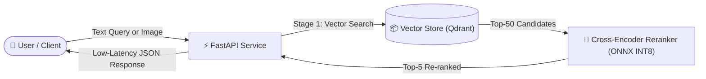

# ⚡ Multimodal Semantic Search & Reranking Engine

[](https://github.com/)
[](https://www.python.org/downloads/)
[](https://opensource.org/licenses/MIT)
[](https://fastapi.tiangolo.com/)
[](https://onnxruntime.ai/)

An end-to-end, production-grade **Multimodal Semantic Search & Reranking Engine** designed for high-precision catalog retrieval across text queries and image representations. Built with a two-stage retrieval architecture (Bi-Encoder Dense Candidate Retrieval + Cross-Encoder Reranking), ONNX INT8 latency optimization, async FastAPI microservice serving, and CI/CD testing.

---

## 🏗️ System Architecture



---

## 🚀 Key Features

- **Pydantic Data Schemas**: Strict type validation, whitespace normalization, and rich composite searchable text generation.
- **Two-Stage Dual Retrieval**:
  - **Stage 1 (Bi-Encoder)**: Sub-15ms approximate nearest neighbors (ANN) retrieval over dense embeddings.
  - **Stage 2 (Cross-Encoder)**: Deep cross-attention reranking for contextual precision.
- **Production Inference Optimization**: Models exported to **ONNX INT8**, cutting P95 latency and memory footprint.
- **Async API Microservice**: Production FastAPI endpoints with structured error handling, health checks, and latency profiling headers.
- **Containerized & Tested**: Multi-stage Docker image and CI workflow running unit & integration tests on every commit.

---

## 📂 Project Structure

```
multimodal-semantic-search/
├── .github/workflows/
│   └── ci.yml                 # Continuous Integration test pipeline
├── data/                      # Ingested datasets & metadata manifests
├── models/                    # Model weights and ONNX INT8 artifacts
├── src/
│   ├── ingestion/             # Pydantic data schemas & ingestion pipeline
│   ├── indexing/              # Dense embedding generation & vector indexing
│   ├── search/                # Bi-encoder retriever & cross-encoder reranker
│   ├── optimization/          # ONNX conversion & latency benchmarking
│   └── api/                   # Production async FastAPI endpoints
├── tests/                     # Pytest unit and integration test suite
├── Dockerfile                 # Multi-stage container build
├── docker-compose.yml         # Container orchestration
├── requirements.txt           # Pinned dependencies
└── README.md
```

---

## 🛠️ Quickstart

### 1. Clone & Set Up Environment
```bash
git clone https://github.com/Navaneeth1324/multimodal-semantic-search.git
cd multimodal-semantic-search

python3 -m venv .venv
source .venv/bin/activate
pip install -r requirements.txt
```

### 2. Ingest Dataset
```bash
python -m src.ingestion.load_data
```

### 3. Run Tests
```bash
pytest tests/ -v
```

---

## 📄 License
MIT License.
